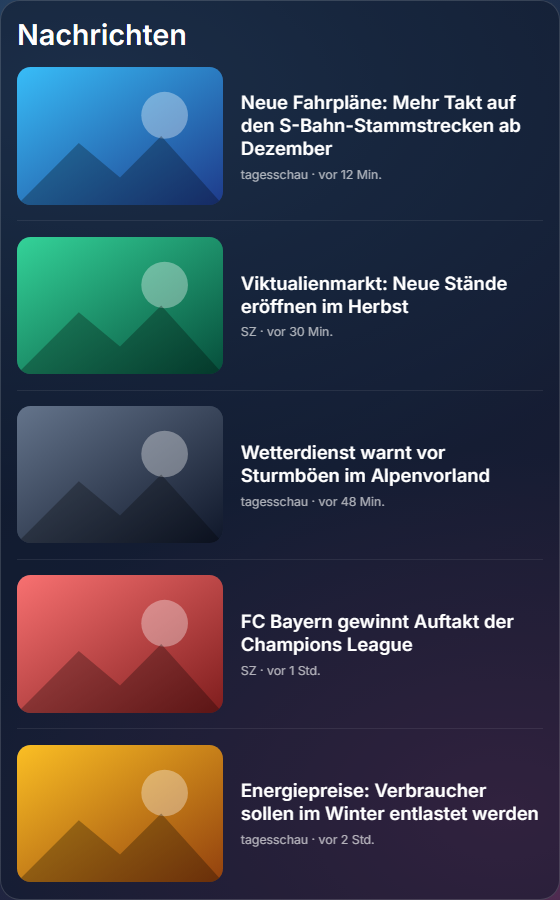

# Nachrichten mit Bildern · News with Images

**[Deutsch](#deutsch) · [English](#english)** · Plugin für / for [Home Screens](https://github.com/home-screens/home-screens) · v0.1.1

<p align="center"></p>

## Deutsch

Aktuelle **Schlagzeilen mit Vorschaubild**, Quelle und Alter – mehrere RSS-Feeds abwechselnd gemischt, damit nicht eine Zeitung alles belegt.

### Was kann das Plugin?

- Vorschaubild, mehrzeilige Überschrift, „Quelle · vor 12 Min.“
- Mehrere Feeds, abwechselnd gemischt, doppelte Meldungen werden entfernt
- Optional nur Meldungen **mit** Bild, Maximalalter einstellbar
- Textgröße getrennt von der Bildgröße einstellbar

### Installation – Schritt für Schritt

**Voraussetzung:** Du hast Home Screens bereits laufen (Server erreichbar im Browser).

1. Öffne den **Editor** deines Home-Screens-Servers im Browser an einem Computer (nicht am Handy; er braucht mindestens 768 Pixel Breite). Die Adresse ist meist `http://<Adresse-deines-Servers>:3000/editor`.
2. Klicke oben in der Leiste auf **Plugins** (neben „Einstellungen“ und „Vorschau“).
3. Klicke auf **Aus URL installieren …**.
4. Füge im Feld **Tarball-URL** diesen Link ein und klicke auf **Installieren**:

   ```
   https://github.com/Gyrosguenter/home-screens-plugin-news/releases/latest/download/news-images.tar.gz
   ```

   Home Screens weist darauf hin, dass das Plugin „nicht vom Home-Screens-Team geprüft“ ist. Das ist normal, denn es stammt nicht aus dem Marktplatz. Du siehst eine Übersicht, was das Plugin darf.
5. Warte, bis die Installation fertig ist, und klicke auf **Fertig**. Falls das Modul nicht sofort in der Liste auftaucht, lade die Seite neu (F5).
6. Ziehe das Modul auf den Bildschirm: Links in der Liste **MODULE** (Hinweis „Auf den Bildschirm ziehen“) findest du unter **NACHRICHTEN & FINANZEN** das Modul **Nachrichten mit Bildern** (mit der Markierung „Plug-in“). Ziehe es auf deinen Bildschirm und passe Größe und Position an.
7. Klicke das Modul an: rechts erscheinen die **Einstellungen**. Der Editor **speichert automatisch**, einen Speichern-Knopf gibt es nicht.

### Einstellungen

| Einstellung | Bedeutung |
|---|---|
| Titel | Überschrift des Moduls. Leer = keine. |
| RSS-Feeds | Feed-Adressen, getrennt durch Leerzeichen oder Komma. `local` = lokale Google-News für deinen Standort. |
| Anzahl Meldungen | 1–10, Standard 5. |
| Schriftgröße der Meldungen | 1 = Standard; kleiner machen, ohne die Bilder zu verkleinern. |
| Nur Meldungen mit Bild | An: Meldungen ohne Vorschaubild werden ausgeblendet. |
| Quelle anzeigen | Name der Zeitung unter der Überschrift. |
| Maximales Alter (Stunden) | Ältere Meldungen verschwinden; 0 = kein Limit. |
| Aktualisierung (ms) | Standard 5 Minuten. |

### Aktualisieren

Wiederhole einfach die Installation mit **demselben Link** (Schritte 2–4). Er zeigt immer auf die neueste Version; deine Einstellungen bleiben erhalten.

### Hilfe bei Problemen

- **Eigene Quellen:** Trag einfach die RSS-Adressen deiner Zeitungen ein. Feeds ohne Bilder werden bei „Nur Meldungen mit Bild“ ausgeblendet.
- **Zu wenige Meldungen?** „Nur Meldungen mit Bild“ ausschalten oder das Maximalalter erhöhen.
- **Installation schlägt fehl?** Dein Home-Screens-Server muss auf `github.com` zugreifen können (Internet). Prüfe, ob der Link vollständig kopiert wurde.
- **Modul bleibt leer nach dem Ziehen?** Seite neu laden (F5). Ein paar Sekunden warten, manche Module laden Daten erst nach dem Einfügen.

### Datenschutz und Hinweise

Die Feeds liest dein Home-Screens-Server (`/api/news`, interne Schnittstelle). Die Vorschaubilder lädt der Browser des Displays direkt von den Webseiten der Zeitungen. **Hinweis:** Die Schnittstelle ist intern und kann sich bei einem Home-Screens-Update ändern.

---

## English

Current **headlines with thumbnail image**, source and age – several RSS feeds mixed alternately so one paper does not take over.

### What does it do?

- Thumbnail, multi-line headline, "source · 12 min ago"
- Multiple feeds mixed alternately, duplicates removed
- Optionally only items **with** an image, maximum age adjustable
- Text size adjustable separately from the image size

### Installation – step by step

**Prerequisite:** Home Screens is already running (server reachable in the browser).

1. Open the **editor** of your Home Screens server in a browser on a computer (not a phone; it needs at least 768 pixels width). The address is usually `http://<address-of-your-server>:3000/editor`.
2. Click **Plugins** in the top bar (next to "Settings" and "Preview").
3. Click **Install from URL…**.
4. Paste this link into the **Tarball URL** field and click **Install**:

   ```
   https://github.com/Gyrosguenter/home-screens-plugin-news/releases/latest/download/news-images.tar.gz
   ```

   Home Screens warns that the plugin "has not been reviewed by the Home Screens team". That is normal because it does not come from the marketplace. You will see an overview of what the plugin may do.
5. Wait until the installation has finished and click **Done**. If the module does not show up in the list immediately, reload the page (F5).
6. Drag the module onto the screen: in the **MODULES** list on the left ("Drag onto the screen") find **Nachrichten mit Bildern** under **NEWS & FINANCE** (marked "Plugin"). Drag it onto your screen and adjust size and position.
7. Click the module: the **settings** appear on the right. The editor **saves automatically**; there is no save button.

### Settings

| Setting | Meaning |
|---|---|
| Title | Heading of the module. Empty = none. |
| RSS feeds | Feed URLs separated by spaces or commas. `local` = local Google News for your location. |
| Number of items | 1–10, default 5. |
| Text size of items | 1 = default; make text smaller without shrinking the images. |
| Only items with image | On: items without a thumbnail are hidden. |
| Show source | Name of the paper under the headline. |
| Maximum age (hours) | Older items disappear; 0 = no limit. |
| Refresh (ms) | Default 5 minutes. |

### Updating

Simply repeat the installation with the **same link** (steps 2–4). It always points to the latest version; your settings are kept.

### Troubleshooting

- **Your own sources:** just enter the RSS addresses of your newspapers. Feeds without images are hidden when "Only items with image" is on.
- **Too few items?** Turn "Only items with image" off or raise the maximum age.
- **Installation fails?** Your Home Screens server must be able to reach `github.com` (internet). Check that the link was copied completely.
- **Module stays empty after dragging?** Reload the page (F5). Wait a few seconds; some modules fetch data only after being added.

### Privacy and notes

Your Home Screens server reads the feeds (`/api/news`, an internal interface). The thumbnails are loaded by the display's browser directly from the newspapers' websites. **Note:** the interface is internal and may change with a Home Screens update.

---

## Technik / Technical notes

- **ID / Manifest:** `news-images` – Version 0.1.1, License MIT
- Bauen / Build: `npm install && npm run build && npm test`
- Release-Archiv für die Installation / Release archive used for installation: `news-images.tar.gz` (enthält / contains `news-images/manifest.json` + `news-images/dist/bundle.js`)
- Teil eines privaten Heim-Projekts (Magic-Mirror-Ersatz); als eigenes öffentliches Repo geführt, damit die Installations-URL ohne Anmeldung erreichbar ist / Part of a private home project (Magic Mirror replacement); kept as its own public repo so the install URL works without login.
- Dieses Plugin ist ein inoffizielles Community-Plugin und steht in keiner Verbindung zum Home-Screens-Team / This is an unofficial community plugin and is not affiliated with the Home Screens team.

MIT
